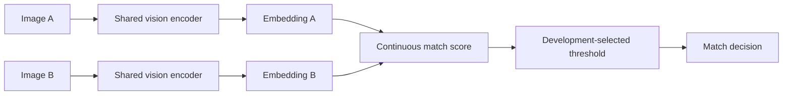

# Precise research brief — supporting discussion note

2026-10-10. This is a short discussion brief, not approval to train or evaluate.

**Current summary — 2026-10-11:** Use the
[central research plan](precise_first_milestone_proposal_20261011.md) for the
architecture sequence, completed audits and remaining decisions. It records
professor approval of image-only learning on whole four-finger slaps and
subject-disjoint, development-selected evaluation principles, followed by
minutiae and optional explanations. Dataset interpretation is the immediate
priority; concrete data/model choices and execution authorization remain open.
This brief provides supporting discussion, not a second implementation plan.

**Proposed question:** Can adapting a pretrained vision encoder for fingerprint
verification approach VeriFinger performance on previously unseen Precise
subjects, and does adding structured minutiae improve TAR at the same FAR?

**Why this question:** The project already compares prompted VLMs and frozen
vision embeddings. The proposed contribution would test fingerprint-specific
learning first, then measure the additional benefit of minutiae. A vision
encoder inherited from a VLM would preserve a connection to foundation-model
adaptation; a dedicated fingerprint encoder is an alternative requiring the
professor's agreement. Language generation is not required for an embedding
matcher. No particular model, loss or training budget is selected here.

**First pipeline:** Start with an image-only shared encoder on whole four-finger
slaps. Add an image-plus-minutiae arm after the baseline is reproducible, under
separate design and task authorization. Per-finger processing would require
parent-capture and anatomical correspondence/fusion decisions. No encoder,
segmentation or matching architecture is implemented by this note.

**Comparison:** The [completed VeriFinger score audit](../../reports/precise-verifinger-audit-20261011/README.md)
reproduces 2,057/2,100 genuine accepts (97.9524% TAR) and 0/2,100 impostor
accepts for fused and summed scores at thresholds 48 and 79. The pooled exports
include thumbs; the four-finger-only slice reports 98.0556% TAR with
slice-specific, evaluation-selected thresholds. Only 60 genuine and zero
impostor pairs overlap the earlier primary VLM manifest. A fair method comparison
requires identical approved comparisons. His message's 0.1% and the screenshot's
0.01% are distinct requested FAR targets; development-threshold provenance,
training exposure and SDK settings remain unknown.

**Evaluation sketch:** Partition subjects before constructing pairs. Training
learns weights, development selects checkpoints/settings/thresholds, and final
test evaluates the frozen system on different subjects. Keep all hands,
captures and derivatives of a subject together. Compare methods on identical
slap comparisons; retain per-finger scores where applicable. Report ROC/DET,
EER, actual test TAR/FAR, trial counts, failures and uncertainty. Existing pair
exclusion alone does not establish a subject-disjoint protocol.

**Preparation evidence:** All 7,358 local JPEG headers opened as 1600×1500
grayscale images; none contained DPI metadata. All 35 selected images decoded.
Visual inspection found contrast, placement, ridge-continuity and contact-area
variation. Actual PPI, acquisition sessions and independent captures remain
unverified. The [inspection report](../../reports/precise-inspection-20261010/README.md)
contains aggregate evidence; identifying review artifacts stay local.

**Decisions for the professor/collaborator:** Must the contribution retain an
LLM/VLM component? Which encoder, loss and comparison arms implement the whole-slap milestone?
Which subjects/images have already been exposed to training or repeated testing?
Which FAR target and threshold-selection procedure apply? What capture metadata,
SDK settings and training objective are available? Split sizes and actual subject
assignments remain undecided.

Supporting explanations are in the [pipeline primer](fingerprint_matching_primer_20261010.md)
and [protocol sketch](precise_protocol_sketch_20261010.md). Fingerprint-specific
embeddings have precedent in [DeepPrint](https://arxiv.org/abs/1909.09901);
that paper motivates this direction without establishing achievable Precise performance.

**Earlier discovery — 2026-10-11 (historical):** Konain confirms VeriFinger-score supervision, but
the two supplied 676-pair files match our older Qwen3 exports. The
[local discovery report](../../reports/precise-collaborator-discovery-20261011/README.md)
records the broader document search and the testing/training records unavailable
at that time. The subsequent intake below supersedes its testing-file request;
training mappings and adapted targets/script remain missing.

**Later intake — 2026-10-11:** The user supplied two Drive links containing
the reported 2,100+2,100 VeriFinger testing records. The
[score audit](../../reports/precise-verifinger-audit-20261011/README.md) now
reproduces 97.9524% TAR and zero observed false accepts at the screenshot
thresholds, and reports both requested FAR targets. These lists include thumbs;
four-finger-only counts and metrics are reported separately. All local image
basenames exist, but only 60 genuine and zero impostor pairs overlap our prior
primary VLM evaluation. Training overlap, acquisition independence, SDK settings
and development-fixed thresholds remain unverified. The training mappings and
adapted script are still needed; no experiment or protocol decision is implied
by receipt of the testing files.
