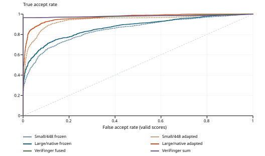

# Precise: DINOv2-Large

Bibesh Pyakurel | Original-resolution evaluation | 2026-11-12

Frozen and adapted DINOv2-Large use all 37,194 supplied training pairs and the same 4,200 testing attempts as the completed small-model and supplied Qwen results. The test set has 2,100 genuine and 2,100 impostor pairs, including 700 of each class per left, right and two-thumb type.

## Actual accuracy before and after adaptation

| Method / checkpoint | Accuracy | TAR | FAR |
| --- | --- | --- | --- |
| DINOv2-small / 448 / frozen | 66.90% | 34.76% | 0.95% |
| DINOv2-small / 448 / adapted | 67.19% | 34.62% | 0.24% |
| DINOv2-Large / native / frozen | 73.26% | 48.24% | 1.71% |
| DINOv2-Large / native / adapted | 83.19% | 67.48% | 1.10% |
| Qwen3-VL-8B / supplied base | 63.31% | 91.76% | 65.14% |
| Qwen3-VL-8B / supplied finetuned | 89.67% | 97.14% | 17.81% |

Large/native adapted-minus-frozen changes: accuracy +9.93, TAR +19.24, FAR -0.62 percentage points.

Accuracy = (TP + TN) / all attempts. TAR is the accepted fraction of genuine pairs; FAR is the accepted fraction of impostor pairs. With balanced classes and zero failures, standard and balanced accuracy coincide; failure counts and policies are shown below.

## Confusion matrices on supplied labels

| Method | TP | TN | FP | FN | Failures |
| --- | --- | --- | --- | --- | --- |
| DINOv2-small / 448 / frozen | 730 | 2080 | 20 | 1370 | 0 |
| DINOv2-small / 448 / adapted | 727 | 2095 | 5 | 1373 | 0 |
| DINOv2-Large / native / frozen | 1013 | 2064 | 36 | 1087 | 0 |
| DINOv2-Large / native / adapted | 1417 | 2077 | 23 | 683 | 0 |
| Qwen3-VL-8B / supplied base | 1927 | 732 | 1368 | 173 | 0 |
| Qwen3-VL-8B / supplied finetuned | 2040 | 1726 | 374 | 60 | 0 |

DINO uses an arm-specific cutoff selected at nominal 1% training-impostor FAR, with failures rejected. Qwen uses native A/B answers; source accuracy counts invalid/errors as incorrect. A rejected failed impostor is not evidence of a successful biometric comparison. These are different operating policies, **not matched test FAR**.

## Larger model, original pixels and measured training time

The new model is **facebook/dinov2-large: 304,368,640 parameters**. Only blocks 22/23 and the final layer norm are adapted (25,198,592 parameters). Both arms start from the same pinned pretrained base; neither prior task checkpoint initializes this training.

All 6,778 benchmark images are 1600 x 1500 pixels. Each entire grayscale raster is centered on a white 1610 x 1512 canvas: 5 pixels on each horizontal side and 6 on each vertical side. RGB replication and normalization follow. **There is no resampling, cropping or stretching, and original files are unchanged.** The model receives 12,420 patches of 14 x 14 pixels; its positional embeddings are interpolated to this grid.

The recorded interval from first attempt start to final selection is **60h 24m 40s**; it includes interruption downtime. The resumed attempt itself took **8.49 hours**. After a segmentation fault during epoch 3, one explicitly reviewed continuation restored the epoch-2 model, optimizer, scheduler and RNG state and replayed the entire third epoch. The partial third-epoch work remains in the execution history and compute cost. No final checkpoint was chosen before completion.

The final trajectory retains 111,582 pair presentations. Across both attempts, at least 130,654 presentations were observed, including the discarded partial epoch. The interrupted log reports periodic progress, so this is a lower bound on total executed work, not an exact compute count.

Recorded training-attempt intervals total at least 29h 49m 30s: first start to the interrupted log's last write, plus the resumed attempt. These are pipeline wall times, not GPU kernel time; the untimed crash tail may add work. Calibration and final testing are separate.

| Fixed item | Executed setting |
| --- | --- |
| Schedule / selection | 3 complete epochs; final epoch chosen before execution |
| Retained trajectory / updates | 111,582 pair presentations / 3,489 updates |
| Batch / accumulation | 1 pair (2 images) per microbatch / 32 microbatches |
| Optimizer | AdamW; LR 1e-05 to 1e-06; warmup 100; matrix weight decay 0.01 |
| Loss / clipping / seed | Cosine contrastive margin 0.2; norm clip 1; seed 2026 |
| Numerics | CUDA/BF16 for training and inference; FP32 normalized CLS/cosines; forced Flash SDPA; deterministic algorithms |
| Memory | Nonreentrant gradient checkpointing; no reduced-resolution or kernel fallback |

## Frozen training-calibrated thresholds

| Native arm | Strict score > cutoff | Training false accepts | Training impostors |
| --- | --- | --- | --- |
| Frozen | 0.894003093 | 185 | 18597 |
| Adapted | 0.902617991 | 185 | 18597 |

The integer false-accept budget is 185 of 18,597 training impostors; ties at the boundary reject. Both selections were sealed before final testing. This is resubstitution calibration, not independent development calibration or a guarantee of 1% test FAR.

## Left hands, right hands and two thumbs

Each row contains 700 genuine and 700 impostor attempts. Every DINO slap type uses its arm's pooled training cutoff. Qwen per-type rates are reproduced from the original parsed decisions on those same pairs.

| Method | Type | Accuracy | TAR | FAR | Failures |
| --- | --- | --- | --- | --- | --- |
| DINOv2-Large / native / frozen | left | 72.43% | 46.57% | 1.71% | 0 |
| DINOv2-Large / native / frozen | right | 72.93% | 47.29% | 1.43% | 0 |
| DINOv2-Large / native / frozen | thumbs | 74.43% | 50.86% | 2.00% | 0 |
| DINOv2-Large / native / adapted | left | 85.50% | 72.57% | 1.57% | 0 |
| DINOv2-Large / native / adapted | right | 86.00% | 72.86% | 0.86% | 0 |
| DINOv2-Large / native / adapted | thumbs | 78.07% | 57.00% | 0.86% | 0 |
| Qwen3-VL-8B / supplied base | left | 61.21% | 98.43% | 76.00% | 0 |
| Qwen3-VL-8B / supplied base | right | 64.93% | 96.86% | 67.00% | 0 |
| Qwen3-VL-8B / supplied base | thumbs | 63.79% | 80.00% | 52.43% | 0 |
| Qwen3-VL-8B / supplied finetuned | left | 92.86% | 98.86% | 13.14% | 0 |
| Qwen3-VL-8B / supplied finetuned | right | 90.71% | 97.43% | 16.00% | 0 |
| Qwen3-VL-8B / supplied finetuned | thumbs | 85.43% | 95.14% | 24.29% | 0 |

The companion CSV also includes all small/448 per-type results and every confusion-matrix count. No type-specific tuning, exclusion of thumbs, segmentation, augmentation or pair regeneration was performed.

## Label and selection treatment

All supplied labels and pairs remain intact. The new cohort has zero disagreements between supplied labels and numeric-prefix equality, so the label-exclusion sensitivity equals the full population. This does not confirm biological identity semantics. SDK zeros remain zero; positive-component-sum selection and unknown template-extraction status limit any claim about performance on the full upstream pool.

## Continuous-score discrimination: descriptive only

| Continuous-score method | Valid scores | AUC | Interpolated EER |
| --- | --- | --- | --- |
| Small/448 frozen | 4200 | 0.8495 | 22.67% |
| Small/448 adapted | 4200 | 0.9416 | 10.95% |
| Large/native frozen | 4200 | 0.8703 | 21.52% |
| Large/native adapted | 4200 | 0.9670 | 8.67% |
| VeriFinger fused | 4200 | 0.9809 | 3.57% |
| VeriFinger sum | 4200 | 0.9801 | 3.57% |

These test-score curves describe ordering; they select no operating cutoff or checkpoint. The SDK arms have no verified non-test calibration here, so only descriptive curves are reported. Qwen supplies binary answers and **has no continuous-score ROC, AUC or EER** in this report.

A lower descriptive EER need not improve TAR at the training-selected cutoff. Larger architecture, native resolution and BF16/Flash execution change together; any observed difference cannot be attributed solely to model size or resizing. Extra ablations were outside the approved proposal.

## What this cohort supports

| Population property | Training | Testing |
| --- | --- | --- |
| Supplied pairs | 37194 | 4200 |
| Unique images | 5721 | 1057 |
| Numeric-prefix groups | 221 | 55 |
| Images reused in multiple pairs | 5721 | 1057 |
| Maximum pairs using one image | 28 | 16 |

Training/testing share zero exact pairs, image paths, numeric-prefix groups, raw-file hashes and decoded image hashes. All 61 leading-zero alias groups are confined to training. **This is numeric-group holdout; biological subject identity and independent captures remain unconfirmed.**

Within-phase pairs reuse images and groups. All testing images recur in multiple pairs. Rates describe this finite cohort; no independent-pair confidence intervals, population low-FAR claims or significance tests are made. One false accept changes pooled FAR by 1/2,100 = 0.0476 percentage points.

## Paired Large/native frozen-to-adapted decisions

| Supplied class | Frozen only accepts | Adapted only accepts | Change in acceptance |
| --- | --- | --- | --- |
| Genuine | 216 | 620 | +19.24 percentage points |
| Impostor | 33 | 20 | -0.62 percentage points |

A positive genuine change increases TAR. A positive impostor change increases FAR. These are paired descriptive counts. The aggregate retains additional paired DINO-to-Qwen counts, without turning binary answers into confidence scores.

Prior results for this dataset were known before this follow-up. This is not an untouched-test or independent-replication claim. No checkpoint, cutoff or hyperparameter was chosen using these final-test summaries.

## Reproducibility and collaborator evidence

Offline checkpoint verification found **0 changed frozen tensors** out of 401; 38 of 38 selected trainable tensors changed. Full epoch membership counts, optimizer update count, final selection, base/checkpoint digests, source commits and saved test completion hashes were verified. This is one fixed-seed run; training-seed variability is not estimated.

Pinned Large revision: 47b73eefe95e8d44ec3623f8890bd894b6ea2d6c. Base weights SHA-256: 399fba97a95f22c36834418bc69373364a99af3a1153da1c0fb31db567c92e23.

Scoring source commit: 12a6df421ac2b12699668480ae741baa50475ac4. Reporting-only commits may be newer; every recorded protected runtime file is checked against its execution commit.

After GPU restoration, scoring used an explicitly reviewed runtime bridge. Training used Linux kernel 7.0.0-42; scoring used 7.0.0-43. The same RTX 4080 SUPER, driver 595.99.02, Python/package/interpreter bytes, image preparation and numerical settings were retained. Driver-version discovery changed from the proc record to nvidia-smi. Original training records and checkpoint bytes were preserved; this is not a claim of identical runtime or bitwise equivalence.

Original training execution source: 06d12c249ec7f5db53124f673b2c6947c4b144b7.

Runtime versions: Pillow 12.3.0, numpy 2.5.3, safetensors 0.8.0, torch 2.6.0+cu124, transformers 5.18.0.

## What the supplied Qwen results establish

All four preserved Qwen prediction files cover the exact new test membership and supplied labels once; their source summaries, prompts and confusion matrices reproduce. The supplied training JSON is byte-identical to the DINO cohort. Adapter bytes and trainer state were inspected without executing collaborator code or unpickling training arguments. Konain owns Qwen fine-tuning; it was not duplicated here.

The supplied Qwen evaluation code starts with original RGB images but invokes its processor, whose saved configuration has resizing enabled. It therefore does not establish unresampled network input. Qwen and DINO preprocessing and operating policies must be described separately.

## Remaining actual-run provenance limits

Konain clarified that a prompt JSON is optional because the prompts are built in. The source confirms this for --prompt_json. Separately, the training script writes binary_training_config.json with selected counts and actual argument values. The fine-tuned summary references that saved file; its contents have not been supplied. No additional prompt JSON is required to reproduce the verified prompt strings.

Training JSON equality and checkpoint-state consistency do not by themselves prove actual complete membership consumption.

The summary references binary_training_config.json, but that actual file has not been supplied.

Resolved base revisions and actual runtime/package versions are absent; the adapter's base identifier differs from the base summary identifier.

The provided adapter is hashed now; no digest in the evaluation summaries proves those exact bytes produced the saved predictions.

Raw generated replies/logs are absent; parsed A/B coverage does not independently establish original response-format compliance.

The final checkpoint state is supplied, but a documented checkpoint-selection history and confirmation of no test-based selection remain absent.

The public report contains aggregate counts, rates and reproducibility digests only. Original images, filenames, private pair rows, model weights and raw responses remain local. All earlier reports and approved decisions are preserved.

Aggregate SHA-256: 614c3d386667723e7a062c4f4da76559c998cbd9af954986f7057458fa3fd6cc
