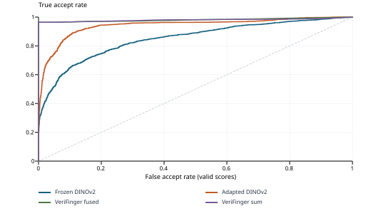

# Precise DINOv2 contribution

Bibesh Pyakurel | Numeric-group holdout | 2026-11-07

Frozen and freshly adapted DINOv2 use the same 4,200 supplied testing attempts: 2,100 genuine and 2,100 impostor pairs, including right hands, left hands and two thumbs. Adaptation uses all 37,194 supplied training pairs. **Numeric filename-prefix groups, images and exact pairs are held out; biological subject identity and capture independence remain unconfirmed.**

## Primary operating-point results

| DINOv2 arm | TAR | FAR | Balanced accuracy | Valid / attempted |
| --- | --- | --- | --- | --- |
| Frozen | 34.76% | 0.95% | 66.90% | 4200 / 4200 |
| Adapted | 34.62% | 0.24% | 67.19% | 4200 / 4200 |

Each arm uses its own pooled cutoff selected from training impostors at nominal 1% training FAR. This is training calibration with resubstitution optimism, not independent development calibration or a guarantee of 1% test FAR. Failures remain attempted comparisons and are rejected in this primary view.

| Arm | Training-selected cutoff | Genuine accepts / attempts | False accepts / attempts |
| --- | --- | --- | --- |
| Frozen | 0.89480340 | 730 / 2100 | 20 / 2100 |
| Adapted | 0.92507052 | 727 / 2100 | 5 / 2100 |

Observed adapted-minus-frozen changes: TAR -0.14 percentage points; FAR -0.71 percentage points. At this fixed cutoff the adapted arm still rejects 1373 of 2100 genuine attempts. Score ordering alone does not establish high acceptance at a strict operating point or statistical superiority.

## LLM comparison status

**Matching fine-tuned Qwen3-VL A/B outputs and actual run provenance for these new pairs have not been supplied.** The older score exports cover different testing attempts and are not substituted. No superiority to Konain's model is claimed. Konain owns VLM fine-tuning.

## Claim supported by this milestone

These are descriptive measurements of agreement with supplied labels on the declared numeric-group holdout. The model starts from the pinned pretrained base; the earlier adapted checkpoint is not reused. Numeric-group separation alone does not prove unseen biological subjects, independent acquisitions, population confidence bounds, or the cause of a VLM limitation.

## Protocol and per-type evaluation

DINOv2-small uses the pinned pretrained revision and whole-image grayscale-to-RGB letterboxing at 448 x 448. Adaptation updates only the final two blocks and final layer norm. The fixed schedule is 3 full epochs; 8 explicit pairs per microbatch; accumulation 4; AdamW LR 1e-05, minimum LR 1e-06; weight decay 0.01; seed 2026; BF16. The final epoch checkpoint is selected in advance. No test-based tuning, extra cross-pairs, segmentation or SDK-zero filtering is used.

| Arm / slap type | Genuine / impostor attempts | TAR | FAR | Failures |
| --- | --- | --- | --- | --- |
| Frozen / left | 700 / 700 | 39.57% | 1.14% | 0 |
| Frozen / right | 700 / 700 | 36.14% | 1.00% | 0 |
| Frozen / thumbs | 700 / 700 | 28.57% | 0.71% | 0 |
| Adapted / left | 700 / 700 | 41.14% | 0.29% | 0 |
| Adapted / right | 700 / 700 | 33.57% | 0.29% | 0 |
| Adapted / thumbs | 700 / 700 | 29.14% | 0.14% | 0 |

All slap types use the same arm-specific pooled training cutoff. Type-specific cutoffs are not selected.

## Label ambiguity sensitivity

There are zero supplied-label disagreements with numeric-prefix equality in training or testing. All supplied labels and pairs are retained. The ambiguity-exclusion view therefore equals the primary result. Leading-zero aliases remain unconfirmed identity semantics, not corrected ground truth.

| Arm | Remaining genuine / impostor | TAR | FAR |
| --- | --- | --- | --- |
| Frozen | 2100 / 2100 | 34.76% | 0.95% |
| Adapted | 2100 / 2100 | 34.62% | 0.24% |

## Paired frozen-to-adapted changes

| Supplied class | Frozen only accepts | Adapted only accepts | Adapted - frozen accept rate |
| --- | --- | --- | --- |
| Genuine | 357 | 354 | -0.14% |
| Impostor | 19 | 4 | -0.71% |

A positive genuine difference increases TAR. A positive impostor difference increases FAR. These are paired descriptive counts, not significance tests.

## Continuous-score discrimination: descriptive only

| Saved continuous-score arm | Valid-score AUC | Interpolated EER |
| --- | --- | --- |
| Frozen DINOv2 | 0.8495 | 22.67% |
| Adapted DINOv2 | 0.9416 | 10.95% |
| VeriFinger fused | 0.9809 | 3.57% |
| VeriFinger sum | 0.9801 | 3.57% |

Curves and interpolated EER describe test score ordering, with no cutoff or checkpoint selection. The SDK arms have no verified non-test calibration here; no operational threshold is chosen from their testing scores. Binary Qwen A/B decisions would supply one operating point, not a score ROC/EER.

SDK values are supplied fused scores or per-finger sums. Raw zeros remain zero. Selection uses positive component sums; template-extraction status is unresolved. Score presence is not proof of successful extraction, and this selected cohort is not a full upstream-pool evaluation.

## Dependence, uncertainty and reproducibility

| Population property | Training | Testing |
| --- | --- | --- |
| Pairs | 37194 | 4200 |
| Distinct images | 5721 | 1057 |
| Numeric groups (identity semantics unconfirmed) | 221 | 55 |
| Images appearing in multiple pairs | 5721 | 1057 |
| Maximum pairs using one image | 28 | 16 |

Training/testing overlap: 0 exact pairs; 0 images; 0 numeric groups. Reused images and groups invalidate an independent-pair binomial interpretation. This report supplies exact denominators, reuse counts and label sensitivity; it does not publish population intervals, p-values or a low-FAR guarantee. One pooled false accept is 1/2,100 = approximately 0.048 percentage points; this resolution is not a population bound.

Cross-phase raw-file and decoded-grayscale hash overlap is zero. All 61 inventoried padding-alias groups occur in training, limiting holdout representativeness. Earlier adaptation saw all new testing images/groups and 1,918 exact testing pairs; that checkpoint is excluded from this run. Prior dataset findings are known, so this is not an untouched-dataset or independent-replication claim.

## Execution and preservation

The user reviewed the concrete protocol and authorized training, calibration and testing on 2026-11-07. That is not a new professor attestation or a confirmation of canonical identities. Original data, labels, scores and collaborator scripts remain unchanged. Private hashes, approval record, epoch checkpoints, calibration scores, test outcomes and failure records remain in ignored local storage.

Fresh pinned-base initialization; 3,489 optimizer updates completed across three full epochs; final checkpoint selected in advance.

Offline tensor verification found 0 changed frozen tensors out of 185; 38 of 38 selected trainable tensors changed. This is one fixed-seed adaptation run; training-seed variability is not estimated.

Execution source commit: b5a6a128b7595afaa5b4dbac4d73cf09cd65788e. Public reproduction uses the shared-pair protocol note, run CLI, aggregate verifier and report renderer. The private input bundle and model/image assets are required separately.

Runtime versions: Pillow 12.3.0, numpy 2.5.3, safetensors 0.8.0, torch 2.6.0+cu124, transformers 5.18.0.

## Remaining collaborator contribution

When Konain's results are available, verify exact testing attempts, actual training membership, prompt and processor, base revision, adapter/checkpoint digest, checkpoint-selection rule, raw replies, parsing and failures. Then add the fixed A/B operating point on these same attempts. A binary answer does not supply a continuous-score ROC/EER. No additional DINO tuning or local Qwen fine-tuning is implied by that comparison.

Aggregate SHA-256: a9fe1678fa8f52e8f1b8f467ff3ceb2a1647fa423bec719a6bf40e85b110b3dc
