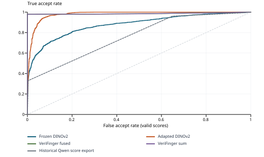

# Precise DINOv2 contribution

Bibesh Pyakurel | Shared-pair benchmark | 2026-11-01

Frozen and adapted DINOv2 are evaluated on the same 4,200 supplied attempts, including right hands, left hands and two thumbs. The approved adaptation uses all 39,290 supplied training pairs. **Testing holds out pairs, while reusing training images and identity groups.**

## Primary operating-point results

| DINOv2 arm | TAR | FAR | Balanced accuracy | Valid / attempted |
| --- | --- | --- | --- | --- |
| Frozen | 41.71% | 0.81% | 70.45% | 4200 / 4200 |
| Adapted | 56.29% | 1.10% | 77.60% | 4200 / 4200 |

Each arm uses its own pooled cutoff selected from training impostors at nominal 1% training FAR. This is training calibration with resubstitution optimism, not independent development calibration or a guarantee of 1% test FAR. Failures remain attempted comparisons and are rejected in this primary view.

| Arm | Training-selected cutoff | Genuine accepts / attempts | False accepts / attempts |
| --- | --- | --- | --- |
| Frozen | 0.89371854 | 876 / 2100 | 17 / 2100 |
| Adapted | 0.93201464 | 1182 / 2100 | 23 / 2100 |

Observed adapted-minus-frozen changes: TAR +14.57 percentage points; FAR +0.29 percentage points. At this fixed cutoff the adapted arm still rejects 918 of 2100 genuine attempts. Better score ordering does not establish high acceptance at a strict operating point or statistical superiority.

## LLM comparison status

**Konain's matching fine-tuned Qwen3-VL A/B results are not ready**, as confirmed by the user on 2026-11-01. No claim of superiority to that model is made. The supplied older Qwen files are 0-100 score exports using a different prompt; their descriptive results appear separately. Bibesh's work does not duplicate Konain's VLM fine-tuning.

## Claim supported by this milestone

These are descriptive measurements of agreement with supplied benchmark labels for held-out pairs of seen images and identities. They do not establish unseen-person generalization, independent captures, population confidence bounds, or the cause of any VLM limitation.

## Protocol and per-type evaluation

DINOv2-small uses the pinned pretrained revision and whole-image grayscale-to-RGB letterboxing at 448 x 448. Adaptation updates only the final two blocks and final layer norm. The fixed schedule is 3 full epochs; 8 explicit pairs per microbatch; accumulation 4; AdamW LR 1e-05, minimum LR 1e-06; weight decay 0.01; seed 2026; BF16. The final epoch checkpoint is selected in advance. No test-based tuning, extra cross-pairs, segmentation or SDK-zero filtering is used.

| Arm / slap type | Genuine / impostor attempts | TAR | FAR | Failures |
| --- | --- | --- | --- | --- |
| Frozen / left | 691 / 671 | 41.39% | 0.75% | 0 |
| Frozen / right | 749 / 756 | 44.59% | 0.53% | 0 |
| Frozen / thumbs | 660 / 673 | 38.79% | 1.19% | 0 |
| Adapted / left | 691 / 671 | 59.91% | 1.04% | 0 |
| Adapted / right | 749 / 756 | 60.61% | 1.19% | 0 |
| Adapted / thumbs | 660 / 673 | 47.58% | 1.04% | 0 |

All slap types use the same arm-specific pooled training cutoff. Type-specific cutoffs are not selected.

## Label ambiguity sensitivity

Twenty-four training and two testing impostor labels disagree with numeric-identity equality for leading-zero aliases. All labels remain as supplied. The secondary result below excludes the two flagged testing rows only; it neither corrects identity truth nor changes training, checkpoints or cutoffs.

| Arm | Remaining genuine / impostor | TAR | FAR |
| --- | --- | --- | --- |
| Frozen | 2100 / 2098 | 41.71% | 0.81% |
| Adapted | 2100 / 2098 | 56.29% | 1.10% |

## Paired frozen-to-adapted changes

| Supplied class | Frozen only accepts | Adapted only accepts | Adapted - frozen accept rate |
| --- | --- | --- | --- |
| Genuine | 275 | 581 | 14.57% |
| Impostor | 16 | 22 | 0.29% |

A positive genuine difference increases TAR. A positive impostor difference increases FAR. These are paired descriptive counts, not significance tests.

## Continuous-score discrimination: descriptive only

| Saved continuous-score arm | Valid-score AUC | Interpolated EER |
| --- | --- | --- |
| Frozen DINOv2 | 0.8776 | 19.76% |
| Adapted DINOv2 | 0.9800 | 6.52% |
| VeriFinger fused | 0.9868 | 2.05% |
| VeriFinger sum | 0.9863 | 2.05% |
| Historical Qwen score export | 0.7612 | 34.03% |

Curves and interpolated EER summarize test score ordering. They do not choose an operational cutoff or checkpoint. SDK and historical Qwen arms have no verified non-test calibration in this report; no thresholded comparison is constructed from their test results.

SDK values are supplied fused scores or per-finger sums. All raw zeros remain zero; template-extraction status is unresolved, so score presence is not proof of successful extraction. Historical Qwen scores have a four-finger confidence prompt despite thumbs in the population, unpinned model/run provenance, and no supplied raw generated replies or adapter attestation.

## Dependence, uncertainty and reproducibility

| Population property | Training | Testing |
| --- | --- | --- |
| Pairs | 39290 | 4200 |
| Distinct images | 6778 | 4869 |
| Numeric groups (identity semantics unconfirmed) | 276 | 276 |
| Images appearing in multiple pairs | 6778 | 2404 |
| Maximum pairs using one image | 26 | 7 |

Training/testing overlap: 0 exact pairs; 4869 images; 276 numeric groups. Reused images and groups invalidate an independent-pair binomial interpretation. This report supplies exact denominators, reuse counts and label sensitivity; it does not publish population intervals, p-values or a low-FAR guarantee. One pooled false accept is 1/2,100 = approximately 0.048 percentage points; this resolution is not a population bound.

## Execution and preservation

The user reviewed the concrete protocol and authorized training, calibration and testing on 2026-11-01. That is not a new professor attestation or a confirmation of canonical identities. Original data, labels, scores and collaborator scripts remain unchanged. Private hashes, approval record, epoch checkpoints, calibration scores, test outcomes and failure records remain in ignored local storage.

Offline tensor verification found 0 changed frozen tensors out of 185; 38 of 38 selected trainable tensors changed. This is one fixed-seed adaptation run; training-seed variability is not estimated.

Execution source commit: 82d02111de2d13378c4be610cbc733923b0637de. Public reproduction uses the shared-pair protocol note, run CLI, aggregate verifier and report renderer. The private input bundle and model/image assets are required separately.

Runtime versions: Pillow 12.3.0, numpy 2.5.3, safetensors 0.8.0, torch 2.6.0+cu124, transformers 5.18.0.

## Remaining collaborator contribution

When Konain's results are available, verify exact testing attempts, actual training membership, prompt and processor, base revision, adapter/checkpoint digest, checkpoint-selection rule, raw replies, parsing and failures. Then add the fixed A/B operating point on these same attempts. A binary answer does not supply a continuous-score ROC/EER. No additional DINO tuning or local Qwen fine-tuning is implied by that comparison.

Aggregate SHA-256: c8cbcceb9e9a969ff4db62783b6fc0d16c3759c66e1b3f2ad230935e2a22de66
